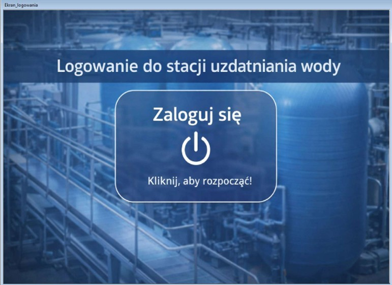
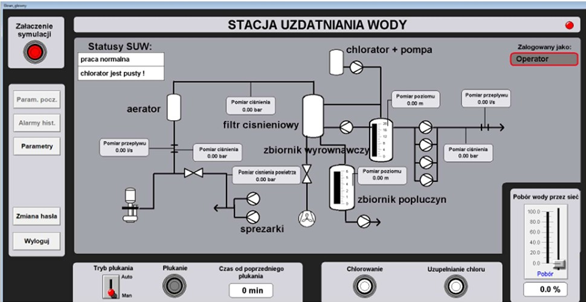
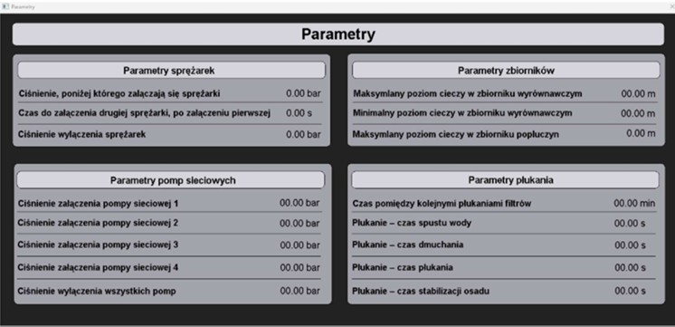

# Stacja uzdatniania wody – AVEVA InTouch

Projekt interfejsu HMI/SCADA dla stacji uzdatniania wody.

## Ekran logowania
Ekran startowy aplikacji z przyciskiem logowania.

## Ekran główny
Schemat technologiczny stacji z pomiarami ciśnienia, przepływu
i poziomu cieczy oraz panelem sterowania symulacją.

## Parametry technologiczne
Panel nastaw sprężarek, pomp sieciowych, poziomów cieczy
w zbiornikach oraz czasów płukania filtrów.

